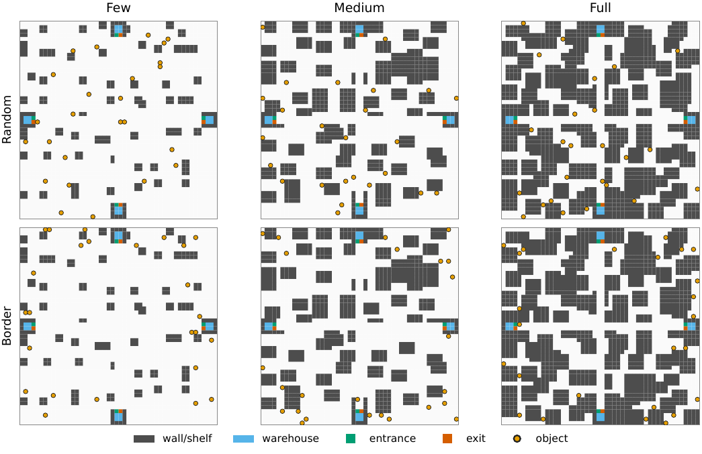
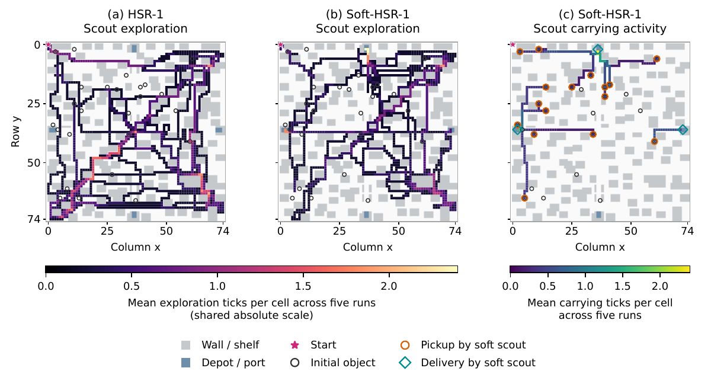

# When Information Does Not Deliver

**Research data and supplementary materials · Complex Intelligent Systems (CIS)**

Companion materials for *When Information Does Not Deliver: The Service-Capacity Cost of Rigid Roles in Energy-Constrained Multi-Agent Foraging*.

**Mario Pavone · Martina Brancaforte · Massimiliano Cassia · Alessio Mezzina · Carolina Crespi**

[Study](#the-study) · [Materials](#materials) · [Protocol](docs/PROTOCOL.md) · [Citation](#citation)



## The study

When object locations are hidden, finding more objects does not necessarily mean delivering more of them. This study asks whether assigning agents exclusively to scouting repays the transport capacity removed from an energy-constrained team.

We compare rigid and soft spatial specialization with generalist exploration under common sensing, routing, allocation, communication and energy rules. In the tested environments, allowing the scout to transport objects recovers almost all of the delivery-AUC loss caused by a rigid role. Coordination through announced intentions helps when communication is available.

## Materials

| Material | Contents |
|---|---|
| [Development maps](study/maps/development/) | 180 instances on 45 topologies |
| [Test maps](study/maps/test/) | 1,620 instances on 270 topologies |
| [Reference instances](instances/) | 18 instances on nine topologies |
| [Map guide](docs/MAPS.md) | File format and coordinates |
| [Experimental protocol](docs/PROTOCOL.md) | Policies and experimental design |
| [Paper figures](figures/paper/) | Six vector PDFs |
| [Scout illustration](illustrations/5-pairs/) | CSV data for the five paired seeds used in the paper |

The simulator and analysis implementation are not included.

## Scout behavior



HSR-1 and Soft-HSR-1 use the same fixed 75 × 75 instance, with five agents, one scout and radio radius 4. Panels A and B share an exploration scale; carrying activity has a separate scale. The visualization illustrates behavior on one topology; quantitative effect estimates are those of the full factorial study.

## Citation

If you refer to this study or its accompanying materials, please cite the article:

> Pavone, M., Brancaforte, M., Cassia, M., Mezzina, A., & Crespi, C. (2026). When Information Does Not Deliver: The Service-Capacity Cost of Rigid Roles in Energy-Constrained Multi-Agent Foraging. *Computers, 15*(10), Article 684. https://doi.org/10.3390/computers15100684

```bibtex
@Article{computers15100684,
AUTHOR = {Pavone, Mario and Brancaforte, Martina and Cassia, Massimiliano and Mezzina, Alessio and Crespi, Carolina},
TITLE = {When Information Does Not Deliver: The Service-Capacity Cost of Rigid Roles in Energy-Constrained Multi-Agent Foraging},
JOURNAL = {Computers},
VOLUME = {15},
YEAR = {2026},
NUMBER = {10},
ARTICLE-NUMBER = {684},
URL = {https://www.mdpi.com/2073-431X/15/10/684},
ISSN = {2073-431X},
DOI = {10.3390/computers15100684}
}
```

Download [BibTeX](citation.bib) or use [CITATION.cff](CITATION.cff).
